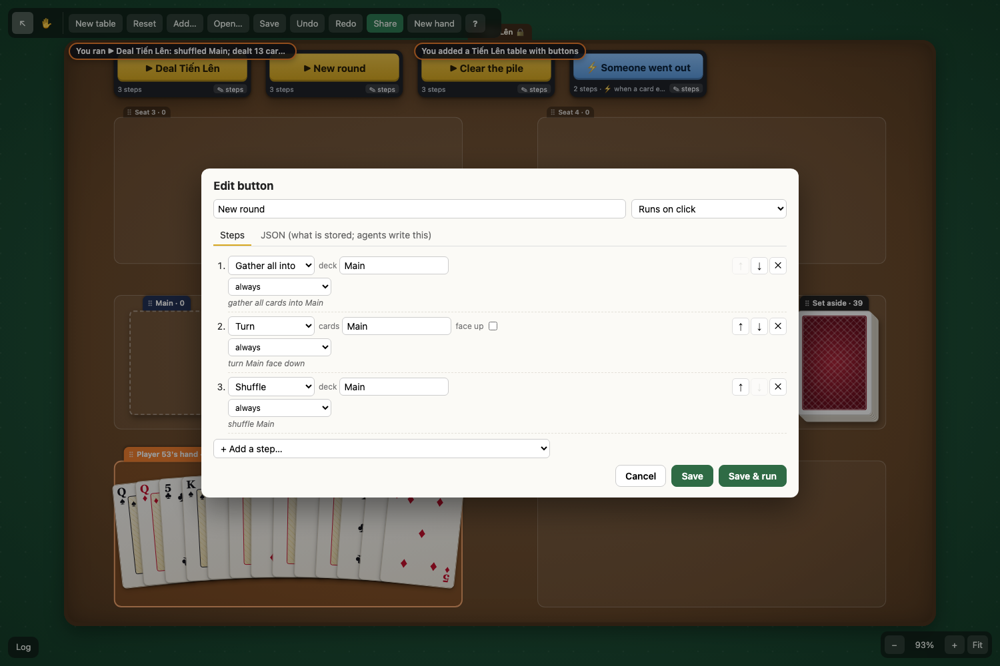
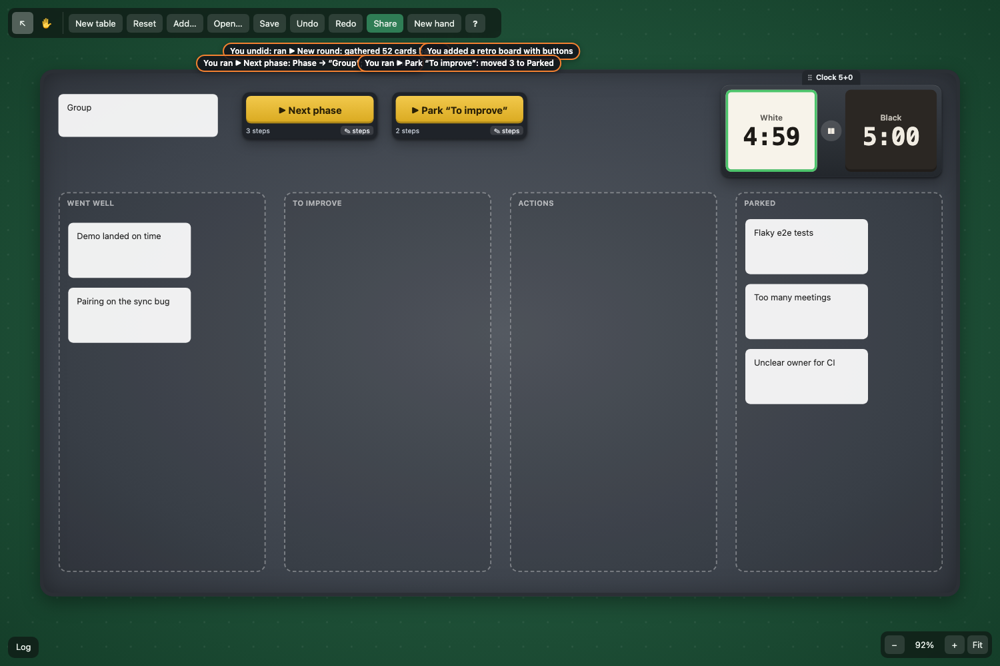

# Idea: automation (buttons as data)

A Button node holds a short list of declarative steps (shuffle "Main", deal 13 to each player, move the rest to "Set aside") that call existing commands, with targets picked by name, kind or place. It is a scripting-lite tier before real scripts: plain JSON in the node, so it syncs, lives in the `.canvas` file, and an agent can write it, while no code runs.

## How it works

- **Node**: a JSON Canvas `text` node (`text: "▶ Deal Tiến Lên"` so other viewers show something) with `x-auto: { name, steps, trigger? }`. Rendered as a big button plus "N steps · ✎ steps". Hover shows the steps in plain words.
- **Steps**: ten verbs: `shuffle`, `deal` (to players' hands), `move` (cards into a container, or notes into an area), `gather` (every card home), `flip`, `clock` (start/pause/reset), `setText`, `cycle` (a note steps through a list), `log`, `stop`. Any step can carry `when: { target, is: 'empty' | 'not-empty', match?: 'all' | 'any' }` ("conditions-lite"). `stop` + `when` gives early exit.
- **Targets**: `{ name?, kind?, in? }`, matched against the doc *as the run has left it so far*: `{name:'Main'}` (zone name, button name, `label`, or a note's first line), `{kind:'hand'}`, `{kind:'card', in:'Pile'}`, `{kind:'text', in:'To improve'}` (by geometry for areas). Short text form in the editor: `Main`, `hands`, `cards in Pile`, `notes in Parked`, `clock`.
- **Schema**: `VERBS` in `model.ts` lists every verb's args with their types. `validateSteps` checks against it (unknown verbs and fields are rejected, numbers have bounds, texts have length limits). It runs on create, edit and run. The editor is built from the same table.
- **Run = one command** (`auto.run`). It uses a new core `Scratch`: each step calls real commands (`cards.shuffle`, `cards.dealHands`, `cards.moveInto`, `cards.recall`, `cards.face`, `clock.*`, `core.move`, `auto.setText`) against a plain copy of the doc. Each call sees the previous calls' changes. The collected changes return as one result: **one undo step, one Yjs transaction (peers never see half a run), one log line** ("ran ▶ Deal Tiến Lên: shuffled Main; dealt 13 cards to …; played 39 cards to Set aside"). A step whose target matches nothing is skipped and said in the same line ("(step 1: nothing matches “Nope”)"). Clock steps go in `untracked` (time doesn't go back on undo, same as the clock's own buttons).
- **Triggers**: `trigger: { on: 'enter', zone }` = "when a card enters this zone". It hooks a new core `store.onDispatch` and looks for `x-cards.stack` sets into the zone. It runs only on the device of the player who moved the card, so it runs once, and it joins the same undo step (`merge: true`). Undo, remote changes and runs themselves never trigger. Shown as a blue ⚡ button, which can also be clicked.
- **Editor**: one row per step (verb select, typed fields, target inputs with a datalist of names on the table, "only if …" row, ↑ ↓ ✕, plain-language line under each row), "+ Add a step", trigger select. A JSON tab shows exactly what is stored and is editable. Errors show live; Save / Save & run go through `auto.edit`, which validates again.

## What's built (branch `idea/automation`)

- Core (`src/core`): `Scratch` (`scratch.ts`: commands composed inside a command), `applyChanges` (plain-doc twin of `Store.apply`, in `doc.ts`), `Store.command(name)`, `Store.viewOf(doc)` (a view with the store's containment/riders/layouts), `Store.onDispatch(fn)` (after each local dispatch that changed something). 4 tests.
- Cards: `cards.moveInto { target, ids }`: cards from anywhere, including inside piles, into a container. `drop`/`gather` only take visible things (UI-shaped).
- Mats: `tienlen` preset (Main home deck, Pile face up, Set aside face down, four seats, a strip for buttons). It is in Add… as plain "Tiến Lên table" too.
- `src/plugins/automation/`: `model.ts` (types, schema, validation, target text), `commands.ts` (resolution, conditions, `auto.run|create|edit|setText`), `presets.ts` (kits as single commands), `editor.ts`, `index.ts` (node type, kits, menu, trigger), `automation.css`. 13 tests (schema, each demo button, undo = one step, missing targets, rule firing, retro, file round-trip + sync, DOM render, trigger in the drop's undo step).
- 246 tests pass (229 on poc + 4 core + 13 automation), `pnpm typecheck` clean. Headless Chromium against 5218: kit from Add…, click Deal, edit New round (add a log step, JSON tab, Save & run), Undo, retro buttons, a real pointer drag of the last card onto Pile firing the rule.

## Demo (port 5218)

1. Open `http://mini.internal:5218` (or `http://localhost:5218` on the Mini).
2. **New table**, then **Add… › Tiến Lên table + buttons** (zoom to fit with `0`).
3. **▶ Deal Tiến Lên**: Main is shuffled, 13 cards go into each present player's seat, the rest goes to Set aside. Open **Log** (bottom left): one line. **Undo**: all of it comes back in one step.
4. Play cards from your hand onto **Pile**, then **▶ Clear the pile** (the pile goes to Set aside face down; on an empty pile it says "nothing to do").
5. **✎ steps** on **New round**: look at the rows; add a step "Log" with text `fresh deck`, open the **JSON** tab, **Save & run**. Everything comes home, face down, shuffled.
6. Rule: edit **Deal Tiến Lên** to deal 1 each, deal, drag your only card onto Pile: the log says "a card entered Pile → ran ▶ Someone went out: played their last card…". One Undo takes back both the play and the rule.
7. Work board: **Add… › Retro board + buttons (work)**. **▶ Next phase** steps the phase note (Brainstorm → Group → Vote → Actions) and restarts the 5-minute timebox. **▶ Park “To improve”** moves the notes from To improve into Parked, laid out in a grid.
8. Agent path: right-click a button › **Copy steps as JSON** (needs https), or in the console `app.dispatch('auto.create', { x: 0, y: 0, name: 'Deal 5', steps: [{ do: 'deal', from: { name: 'Main' }, count: 5 }] })`.

Multiplayer needs signaling (`pnpm dev:signal` on 5192); it isn't started here. In a room, "deal to players" deals to everyone present.

## What the command API lacked for steps

- **Composition.** Commands are pure `doc → changes`, so composing them needed only two things that existed but weren't exposed: the store's view builder (`viewOf`) and command lookup (`command`). Plus a plain-doc `applyChanges`. A nested `ydoc.transact` was not an option: the store's view cache is reset only in `afterTransaction`, so step 2 would read stale state.
- **Target resolution.** Commands take ids. Steps need names, and nodes had no common "name". The resolver tries zone name, button name, `label`, then a note's first line. A core `name`/`tags` field (or a `nameOf` registry per plugin) would make this one rule instead of a guess per kind. "Kinds" are also per plugin (`isDeck`, `isZone`, `isClock`…); a core `kindOf` per ObjectType would help.
- **Return values / chaining.** None needed in practice: each step resolves its targets again against the scratch doc, so "deal" creating hands is visible to the next "flip hands". Commands that need an id they just created (a new group from `gather`) would want a result value (`select` is the closest thing today). Steps could name results (`as: 'dealt'`) if that comes up.
- **UI-shaped commands.** `cards.drop`, `cards.gather` and `cards.face` act only on *visible* cards (they mirror gestures). An automation wants "these cards, wherever they are". That needed `cards.moveInto`. Turning one card inside a pile still can't be done.
- **Idempotency.** Commands are mostly no-ops when there's nothing to do (good). The clock isn't: "start" had to look at the clock's state to choose `tap`/`resume`/`reset+tap`. Commands with declarative intent (`clock.set { running: true }`) suit steps better than toggles.
- **Arg schemas.** Steps carry their own schema (`VERBS`). That's the same need agent-bridge (MCP tools) and plugin-loader (manifest) hit. If commands declared arg schemas (`describe`), steps could call *any* command (`{ call: 'cards.sort', args }`), validated generically, and `VERBS` would shrink to sugar.
- **Hooks.** Triggers needed `onDispatch` (local dispatch only). Guessing from Yjs transactions can't tell undo, load and remote changes apart without private origins.
- **No generic text edit.** Core has no "set a note's text" command (`auto.setText` fills in; eventstorm and components hit the same gap).

## Fit with the vision, host model, stage 4

- **Agent-native**: the steps *are* the agent API at a level a person can read and edit. An agent can write a button with one `auto.create` and the schema tells it exactly what's allowed. Validation errors are readable sentences.
- **Local-first / files**: buttons live in the `.canvas` file and survive save/load. Targets are names, so a button keeps working after New round, on a copied table, or in another file with the same names.
- **Host model**: `auto.run` is a pure command, so it can run anywhere the store runs: today on the clicking peer, later **on the host**. In the host model steps must run there whenever they touch secrets. "Deal face down" (a real secret deal), "shuffle" (order hidden from players), "if the deck is empty" (needs the hidden count when counts are hidden) all need host-side state. The step list is a good unit to send to a host: data, validated, no code. A rule with a trigger should run on the host only (one runner, no "who moved it" election). Today, `onDispatch` on the acting peer stands in for that.
- **Stage 4 scripts**: steps are the "no-code" end of the same ladder. A stage 4 script (QuickJS on the host) would receive the same `Scratch`-like capability (call commands, read the doc, return changes as one step). Steps can compile to that call sequence. Buttons stay the UI for both: a button whose action is steps or a script. The trigger vocabulary (`enter`, later `onFlip`, `onTurn`, timers) is the script event API in miniature.

## Open questions

- Who runs a timer trigger ("every 60s", "when the clock flags")? It needs one elected runner (the "one writer" service in the synthesis) or the host. Not built for that reason.
- Should step targets also accept ids (precise, breaks on copy) or tags set by the user ("Name for automations…" on any node)? Names collide: two zones called "Pile" both match.
- How much logic before it's a script? `when` + `stop` covers "if empty → skip". Loops ("deal until…"), variables and prompts ("how many cards?", as playingcards.io has) push towards stage 4.
- Can a rule trigger another rule? Today runs never trigger, so no cascades and no loops.
- Permissions: anyone can edit any button; on a shared table, should editing steps be owner-only, like hands?
- Deal 13 to "players" uses who's present. Tiến Lên with 2–3 players sets the rest aside, which is the real rule. "Seats" as a concept (empty seat = no deal) may be cleaner than presence.

## Effort

About a day of work for the prototype. To production: arg schemas on commands (shared with agent-bridge/plugin-loader) ~1–2 days; a `name/tags` core field + "Name for automations" UI ~0.5 day; prompts and timer triggers wait for the host/service election; host execution comes with stage 3.
