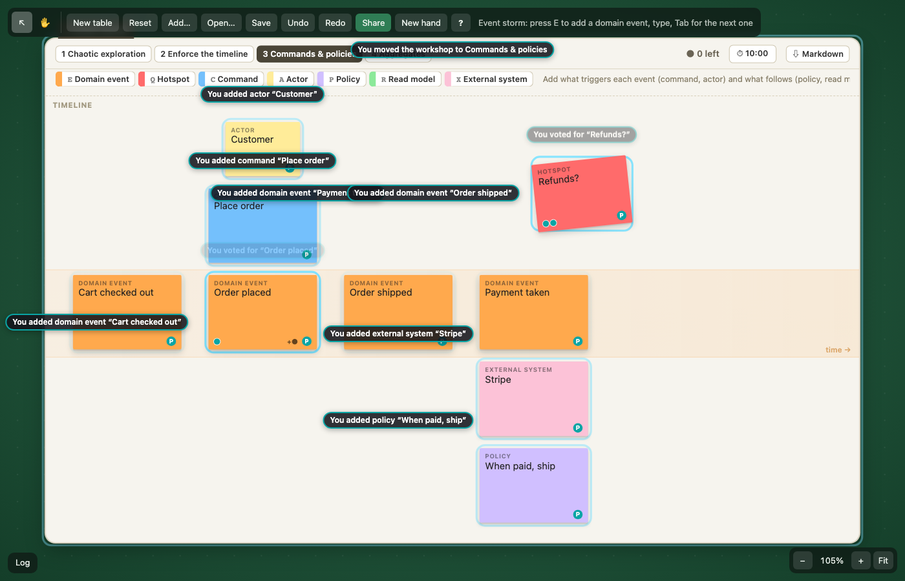

# Idea: eventstorm (where diagramming fits)

An event storming kit built as one plugin on the same "pieces on a table" model as the games: stickies are pieces, the timeline board is a surface that carries them. A workshop runs on it (phases, dot voting, a timebox, a log of who added what), and the result exports as Markdown an agent can read.

## How it works

- **Board** = a JSON Canvas `group` node with `x-storm: { kind: 'board', phase, lanes, dots, timer }`. Header: phase switch, sticky palette (only kinds the phase offers), your votes left, timebox, Markdown export. Body: swimlanes, each with a highlighted event row in the middle ("time →").
- **Sticky** = a `text` node (its `text` is the words, so any JSON Canvas viewer still shows them) with `x-storm: { kind: 'sticky', st, on?, by?, v_<player>: n }`. Eight kinds with the standard colors: domain event (orange), command (blue), actor (small yellow), aggregate (big yellow), policy (lilac), read model (green), external system (pink), hotspot (red, rotated).
- **Riding**: one rider rule. A sticky with `on: <event id>` rides that event; anything else rides the board under its center (geometry, like a mat). Moving an event takes its command/actor/policy along; moving the board moves everything.
- **Timeline**: positions are stored, not derived. In phases 2–4, commands re-pack the board: events sorted by center x, one slot each (`COL` = 200px), snapped to their lane's event row; attached stickies stack above (actor, command, aggregate) or below (policy, read model, external, hotspot) their event. Re-pack runs after a drop (`storm.settle`, joined to the drag's undo step), on a new sticky, on a phase switch. Reorder = drag an event between two others.
- **Attach**: drop a non-event sticky in an event's column (same lane) → `on` is set; drop it elsewhere → let go. A new sticky made with an event selected attaches to it.
- **Fast capture**: one key per kind makes a sticky (at the pointer, or attached/chained per selection) and opens its editor. Enter commits, Shift+Enter newline, Tab commits and chains the next one (an event: next slot on the timeline; others: same kind on the next event), Esc drops an empty new one. Creating + typing is one undo step.
- **Facilitation**: phase switch (Chaotic exploration → Enforce the timeline → Commands & policies → Aggregates) changes the palette and keys offered and turns on packing; switching into phase 2 snaps the chaos into one sequence (one undo puts it back). Dot voting: `.` / `,` on the sticky under the pointer, budget per person per board (default 3), voter-colored dots; votes are flat keys `v_<player id>` so two people voting at once both count. Timebox: one countdown per board, same "time left + since" sync model as the game clock, logs "Timebox is over".
- **Agents**: `app.dispatch('storm.add', { board, kind, text, by: { id, name, color } })` adds a sticky; the log names `by` (not the local player) for its first words. Renames name the person who renamed.
- **Event log**: "Alex added domain event “Order placed”", "renamed …", "moved the workshop to …", "voted for …". Each sticky also stores `by` (author dot on it, name in the export).
- **Export**: `toMarkdown(doc, board)`: numbered events in timeline order, lane, votes, author, attached stickies in flow order (actor, command, aggregate, external, read model, policy, hotspot); then loose stickies per kind; then the top 5 by votes. Shown in a dialog (copy / download `.md`) and on `window.storm.markdown()` for an agent driving the page.

## What's built (branch `idea/eventstorm`)

- `src/plugins/eventstorm/`: `model.ts` (kinds, phases, geometry, rider rule), `commands.ts` (pure: createBoard, add, text, kind, settle, tidy, phase, lanes, dots, vote, timer, detach, reset, repair), `markdown.ts`, `render.ts`, `logic.ts` (registers commands, rider rule, reset, repair), `index.ts` (types, keys, inline editor, menus, kit, timer ticker), `storm.css`, `commands.test.ts` (17 tests).
- `src/main.ts`: `app.use(stormPlugin)`. `src/help.ts`: an "Event storm" group.
- Core: **no changes**.
- Tests: 246 pass in the whole suite (17 are eventstorm's). `pnpm typecheck` clean. Checked in headless Chromium against the dev server on 5213 (keys, typing, Tab chaining, phase snap, drag reorder, attach, votes, timebox, export, undo of create, Esc, fallback of shared keys to cards).

## Demo

1. `pnpm exec vite --port 5213 --strictPort --host 127.0.0.1` in the worktree, open it (from another Mac: `http://mini.internal:5213`, through the Mini's proxy).
2. New board (or not: the board lands in the middle of the view, on top of whatever is there; drag its tab to move it), then **+ › Event storm board**.
3. Pointer on the board, press **E**, type `Order placed`, **Tab**, `Payment taken`, **Tab**, `Order shipped`, **Enter**. Point lower left, **E**, `Cart checked out`, **Enter**. **Esc** (deselect: with a sticky selected, a new non-event sticky attaches to its event instead of going to the pointer), point elsewhere, **Q**, `Refunds?`, **Enter**.
4. Click **2 Enforce the timeline**: the events snap into one sequence (Cart checked out first). ⌘Z and redo to see the chaos come back.
5. Click **3 Commands & policies**. Click `Order placed`, press **C**, `Place order`, Enter; **A**, `Customer`, Enter. Click `Payment taken`, **X** `Stripe`, **P** `When paid, ship`.
6. Drag `Order shipped` onto the gap between `Order placed` and `Payment taken`: it slots in, the timeline re-packs; drag `Order placed`, its command and actor follow.
7. Point at stickies and press **.** to vote (3 per person; header shows how many are left).
8. Click **⏱ 10:00** to start the timebox (right-click the board tab for its length, lanes, votes per person, rename).
9. Click **⇩ Markdown**: the flow as Markdown (copied right away on localhost/https; over plain http, e.g. `mini.internal`, use **Copy** in the dialog). Open **Log** (bottom left) for who added what.
10. Swimlanes: right-click the board tab › Swimlanes… › `Customer, Shop, Warehouse`.

## What it says about the core / plugin API

Fit well:
- **Riders** are exactly "this command belongs to that event": attach = set one field, moving/reordering comes free, transitive riding (sticky → event → board) just works through `withRiders`.
- **Commands as pure data**: the timeline pack is a plain function of the doc; `onDragEnd` + `store.merged` put the re-pack in the drag's undo step. Phase switch + pack = one undo step.
- **Event log** needed nothing new: "who added what" is just `events` on commands. `key` dedupes repeated votes.
- **Per-field Y.Map merges**: `v_<player>` keys make concurrent voting safe without any CRDT work.
- **Kits, menus, `data-action` controls, `grabbable`/`boxSelectable`** (borrowed from the locked mat pattern) covered the board's UI.
- **JSON Canvas**: stickies as `text` nodes stay readable in Obsidian; the round trip test keeps attachments.

Got in the way / gaps:
- **Keys are one binding per key, last wins.** E, P, G were taken by cards (spread, play, group) and R by the clock (rotate). I wrapped them (`chainKey`: mine when a board is the context, else the old binding). Core should keep a list per key and run the first whose `when` passes; plugins need a "context" (which object/board the user is in) to scope keys. With many plugins (marketplace), key collisions are the first thing to break.
- **No text editing in core.** Every work tool needs inline text; I built a textarea editor with capture-phase listeners to keep core's pointer/key handling off it. Core should offer an `editText(id, field)` primitive (and a "typing" mode that suspends bindings).
- **Mats didn't fit.** Mat zones are card containers (layout, max, facing, visibility are card concepts); a sticky isn't a card and a timeline isn't a pile. What I reused from mats is the idea (a locked surface carrying pieces by geometry, a grip tab). A generic "surface with regions" (lanes, columns, slots) would serve both: mats = regions that are card containers, the storm board = regions that are lanes. **Zones/layout** helped as a model (pack = layout), but cards' layouts are derived on read for contained nodes, which would hide stickies from direct manipulation; stored positions + re-pack commands worked better for work diagrams. **Facing/privacy** were irrelevant (maybe useful later: silent brainstorming where stickies are private until revealed is exactly "a hand").
- **No pointer position on `App`.** Kits get the view center; keys get nothing. I tracked the pointer myself. `app.view.pointer` (world) would help any "create here" key.
- **`core.delete` takes riders.** Deleting an event deletes its attached stickies (like a board takes its pieces). Right for chess, debatable here (detach would be kinder). A plugin hook "what happens to riders on delete" would let each kind choose.
- **Edges unused.** Event storming flows are mostly spatial; but policies → commands are arrows in the real method. Core has edges in the doc but no rendering/editing of them yet.

## Fit with the big vision

- **Multiplayer**: all state is synced plain fields; votes per player can't clobber; the phase lives on the board, so the facilitator switches it for everyone; timer uses the clock's skew-tolerant model. Editing is local until commit (others see an empty sticky while you type, the text on Enter; live co-typing would need Y.Text). A `repairs` hook re-packs a board on every peer after a remote change leaves two events in one column or two attached stickies on one spot (two events added at the same moment, in one lane or two); an event someone is dragging is off its slot, so it never counts.
- **Agent native**: the Markdown export is the read side (ordered, plain, no coordinates). The write side is already there: an agent can `app.dispatch('storm.add', { board, kind: 'event', after, text })` and the board lays itself out; commands validate args. Next: expose commands + `toMarkdown` as tools (MCP) so an agent can join a workshop as a participant (propose events, flag hotspots, answer "what's missing between X and Y").
- **Local first / hosting**: everything is in the `.canvas` file; it opens in Obsidian as colored text cards. Git-tracked boards diff badly because positions are stored; the Markdown export could be committed alongside as the reviewable artifact.
- **Host/secret model and marketplace security**: the plugin needs no secrets, no network, no private state. It overrides shared keys, which is a marketplace concern: a plugin shouldn't be able to silently take another's keys (core-managed key scopes). The privacy model (hiders, private log texts) would fit "silent brainstorm then reveal" without new trust.

## Known gaps (not fixed at merge)

- `by` is an argument, so the log is only as honest as the caller. Follow-up once the bridge's `CommandCtx.actor` is in poc: take the actor from the context in `logActor` (`commands.ts`) and drop `by` from the log.
- Peers see an empty sticky while you type (text commits on Enter); live co-typing needs Y.Text.
- A clash re-pack while someone drags an event moves that event under their pointer; the rest of the drag is offset and the drop can land in the wrong slot (needs a concurrent add mid-drag). Loose stickies on one spot are not separated.
- Esc on a fresh sticky leaves an empty undo step.
- Key wrappers (`chainKey`) stay until core has a list per key; no key scopes.
- Deleting an event deletes its attached stickies; no arrows (policy → command); no MCP tools yet.

## Open questions

- Should packing be derived (a layout) instead of stored? Derived = no stale positions after concurrent edits, but needs core support for "laid out yet directly draggable" nodes.
- Live co-editing of sticky text (Y.Text per sticky) vs commit-on-Enter.
- Aggregates: big yellow stickies sit above their event now; real sessions group several commands/events under one aggregate. A "group/frame" primitive (bounded contexts too) is the missing shape.
- Silent writing phase (private stickies, reveal all at once) = cards' hand model on stickies?
- Arrows (policy → command) as edges.
- One board per workshop or many (big picture vs process level)?

## Rough effort to make it real

- Core: key scopes + list per key (1 day), text editing primitive (1–2 days), pointer on view (hour), riders-on-delete hook (hour), edges render/edit (3–5 days).
- Plugin polish: insertion marker while dragging, re-pack on remote changes, Y.Text live typing, frames for aggregates/bounded contexts, silent phase, agent tool surface (≈1–2 weeks total).
