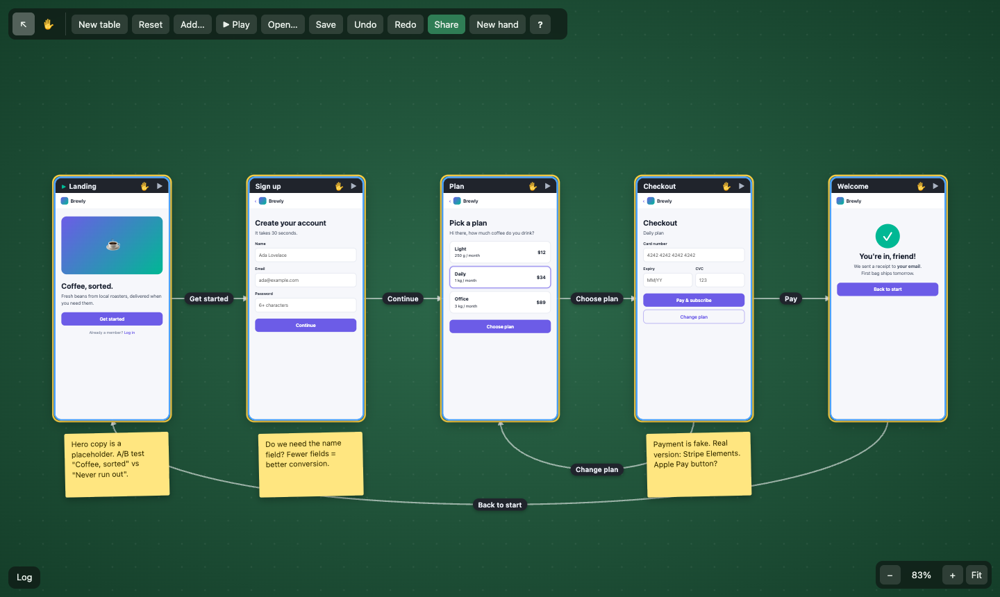
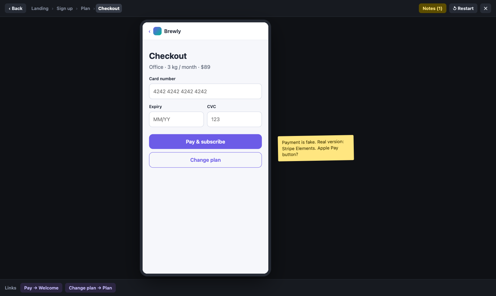
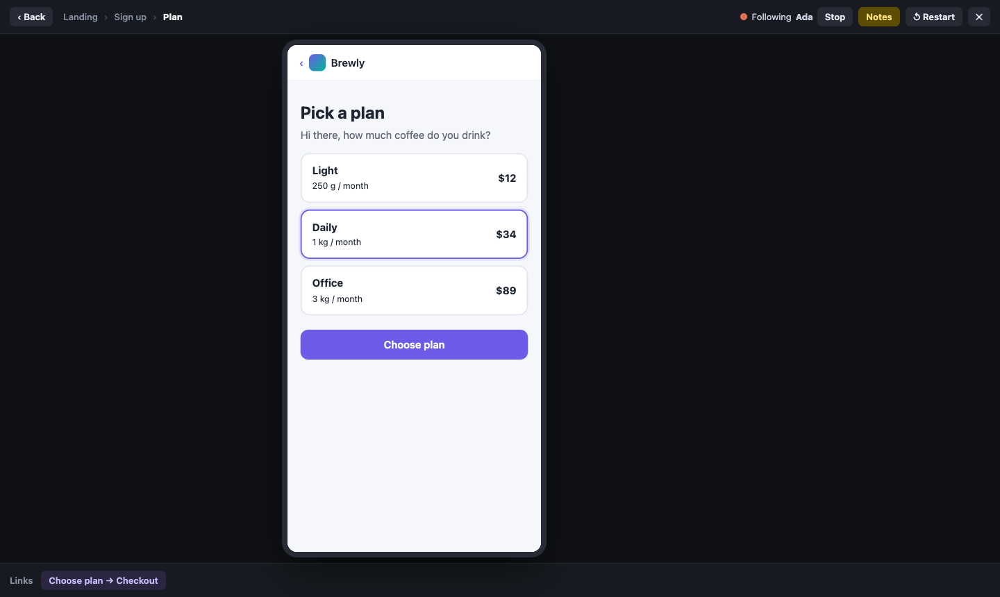

# Idea: prototype — HTML pages as canvas nodes

**The idea.** A page node holds a whole HTML document (what an agent generates for a mock or flow), rendered live and sandboxed, scaled into the node. Arrows between pages are navigation: the page's buttons follow them, and Play walks the flow full screen like a Figma prototype, with notes beside each screen and others able to follow the presenter.

## How it works

- **Page** = JSON Canvas `text` node with `x-page: { title, html, vw, start? }`. `text` holds a short markdown stand-in, so Obsidian shows a card. The HTML lives in the canvas, so it syncs (Yjs), saves to the `.canvas` file and undoes like any field.
- **Render**: `<iframe sandbox="allow-scripts" srcdoc>` laid out at the device width (`vw`: 390 / 820 / 1280) and CSS-scaled to the node width. Canvas zoom then scales the world as usual. No pointer events by default, so a page is a draggable thumbnail. **Interact** (I or ✋) turns pointer events on for that page on this screen only.
- **Links** = plain JSON Canvas edges, `label` = the action ("Continue"). In the page, `data-goto="X"` resolves in this order: an outgoing edge labelled X, else an outgoing edge to a page titled X, else any page titled X (with a hint that no edge exists yet), else nothing. An empty `data-goto` follows the only outgoing edge. `data-back` goes back. A button inside a `<form>` runs `reportValidity()` first, so required fields work.
- **Bridge**: a script injected before the page's HTML posts `{tag, kind: goto|back|set|escape}` to the parent. The parent accepts only messages from a known frame (`e.source === frame.contentWindow`) with that exact shape. `data-store="key"` keeps a field value in a session state; `data-show="key"` displays it on a later page ("You're in, Ada!"). Scripts get `canvas.goto/back/set/state`.
- **Canvas mode**: in an interactive page, a link click makes the view glide to the target page, flash the edge it followed, select the target and turn on its interact.
- **Play** (▶ toolbar, ⇧↵, ▶ on a page): a full-screen overlay showing the device frame, a Back button (←), a clickable breadcrumb of the path (revisiting a page folds the loop), outgoing links as chips (pages with no link markup still work), the page's sticky notes beside it (N), Restart (R) and Esc. Edits made by anyone while you play show up live.
- **Notes**: yellow stickies (`text` node, `color: "3"`, `x-page: { note: true, on }`). A note dropped on or near a page attaches to it (rider rule), moves with the page and appears beside it in Play.
- **Flow overview**: right-click the table › Arrange pages as a flow. Pages go left → right by BFS step from the start page, with notes travelling along. Back-links loop underneath with their labels. **Auto-link** turns every `data-goto` that names an existing page into a labelled edge (label = link text), so a pile of agent-made pages becomes a flow in one click.
- **Follow the presenter**: while you play in a room, awareness carries `play: { page, path, state }` (ephemeral, not in the doc). Others see a "Ada is presenting Plan · Follow" banner. Followers mirror the presenter's page, path and form state. Navigating yourself stops following.

## What's built (branch `idea/prototype`)

- `src/plugins/prototype/`: `model.ts` (fields, link resolution, flow order, `data-goto` scan), `commands.ts` (`page.create/edit/device/scale/start/link/unlink/autoLink/arrange/note/noteText/attach/seed`, all plain data in and changes out), `bridge.ts` (srcdoc + CSP + message validation), `edges.ts` (SVG edge layer with labels), `play.ts` (Play + follow), `editor.ts` (code editor with live preview), `history.ts`, `io.ts` (import repair), `seed.ts` (5-screen "Brewly" signup → plan → checkout → welcome flow), `index.ts` (types, menus, keys, kits).
- Tests: `prototype.test.ts` (13 tests: seed, link resolution, flow order, arrange, undo, delete drops edges, auto-link, note attach, file round-trip + import repair, srcdoc can't be broken out of, message validation, play history) plus 2 core edge tests. 244 total pass (229 before). `pnpm typecheck` is clean.
- Browser-checked headless (Chrome via playwright-core, port 5215). Canvas link following, the full Play flow with validation and carried state, Back, breadcrumb, chips, Esc, the editor, arrange, and two tabs in one room with follow / stop-following all work. A probe page confirmed parent access, localStorage, cookies, fetch, images and top navigation are all blocked.

## Demo

1. `cd ~/code/canvas-wt/prototype && pnpm exec vite --port 5215 --strictPort`, then open http://localhost:5215.
2. **Add… › Prototype: example signup flow**: 5 phone pages with labelled arrows and 3 notes.
3. Click **Landing**, press **I** (or its ✋). Click **Get started** inside it: the view glides to Sign up and the arrow flashes. Esc inside the page stops interacting.
4. **▶ Play** in the toolbar: the Sign up form refuses empty fields. Type a name and an email, Continue; Plan greets you by name. Pick Office, Choose plan; Checkout shows the plan. Pay, and Welcome says "You're in, <name>!". Try Back, a breadcrumb item, the link chips at the bottom, N for notes, R to restart, Esc to exit.
5. Double-click a page (or ↵): edit its HTML with a live preview, change the device, ⌘↵ saves (one undo step).
6. Drag pages around, then right-click the table › **Arrange pages as a flow**.
7. Right-click a page: **Link to ›** another page (asks for the action label), **Links from here ›** rename/remove, Start page, Device, Size, Add note. Right-click the table › **Auto-link page links** after adding pages whose HTML has `data-goto="Title"`.
8. Multiplayer: click Share (needs signaling, `pnpm dev`). Or open `/?room=x&signal=ws://127.0.0.1:9` in two tabs of one browser (BroadcastChannel syncs them). Play in one tab; the other shows **Follow**.
9. Agent path, from the console: `app.dispatch('page.create', {x:0, y:0, title:'Pricing', html:'<h1>…</h1><button data-goto="Checkout">Buy</button>'})`, then `app.dispatch('page.autoLink', {})`.

## What it says about the core / plugin API

**Fit well**
- ObjectType `render` / `renderKey`: the key is `[x-page, width, height]`, so moves and selection never reload a frame (checked: one load per page).
- `onAction` covers the header buttons, `onDoubleClick` the editor, the rider rule notes on pages, `registerMenu` (nested), `registerKit`, `registerKey` with `when`, import filter, duplicate rule, event log entries.
- Commands as plain data made agent use, tests and undo free. Edit + device change merge into one undo step via `store.merged`.
- Presence `awareness` is reachable for custom ephemeral fields (`play`).

**Had to change in core (small)**
- `Change` gained `{op:'edge', edge}` (add/replace, skipped if an end is missing) and `{op:'delEdge', id}` (`doc.ts`, `store.ts`, about 10 lines plus 2 tests). Before this, commands couldn't touch edges at all.
- `main.ts`: registers the plugin and adds a ▶ Play toolbar button. `help.ts`: a "Prototype pages" group.

**Gaps found (worth fixing in core later)**
- **Core draws no edges.** The plugin mounts its own SVG layer into `app.view.world`. Edges should be core (render, select, label edit, delete), with plugins styling them.
- **No resize handles.** Size goes through menu commands (Device, Larger/Smaller).
- **Clicks inside the table are captured**: `setPointerCapture` on the root means a button rendered over the table (an overlay or banner) never gets its click. The follow banner had to move to `document.body`. Core could offer an overlay layer that's excluded from capture.
- **Keys inside an iframe never reach `window`.** The bridge has to forward Escape. The same will hold for every iframe-hosted plugin.
- Presence is set after plugin `setup` (rooms join later), so a plugin can't hook awareness in setup. An `app.onPresence(fn)` hook would help; I subscribe to the store and wait.
- No per-viewer local UI state API ("interact" is a Set in the plugin, applied via `boxOf(id).classList`). Mats does the same for edit mode, so a small pattern for this would help.

## Fit with the big vision

- **Multiplayer**: pages, edges and notes are doc data, so everyone sees the same flow live, including edits during Play. Play position, path and form state are presence (ephemeral), which gives follow-the-presenter. Not done: shared interact state (each viewer's pages are separate sandboxes; typing in one tab doesn't show in the other's thumbnail).
- **Agent native**: HTML is exactly what LLMs emit. An agent can `page.create` screens, `page.link` or `page.autoLink` them, `page.arrange` them and leave notes, all through the same commands a person uses. A future agent could also read the session state / path from a Play run (usability testing) or react to notes ("make the CTA bigger").
- **Local first / hosting**: the HTML lives in the `.canvas` file, so it works offline and survives a git commit. For git-tracked hosting, a page could instead be a JSON Canvas `file` node pointing at `pages/checkout.html` (real files, diffable, editable in VS Code), with the plugin reading the file. That's the natural next step and fits "git-tracked files" hosting. Large HTML in one Y.Map field is last-writer-wins; real co-editing of a page would need Y.Text.
- **Security model** (same as a future plugin sandbox):
  - Untrusted HTML from agents or other players runs in `sandbox="allow-scripts"` without `allow-same-origin`. That means an opaque origin: no canvas DOM, no IndexedDB/localStorage, no cookies, no forms, no popups, no top navigation.
  - A CSP `<meta>` placed before any page content (a script can't lift it) blocks fetch/XHR/WebSocket, remote images, fonts and CSS. Only inline code and data: URLs are allowed, so pages can't exfiltrate or phone home.
  - The only channel is postMessage with a validated 4-message vocabulary.
  - Known holes: WebRTC from inside the frame isn't covered by CSP in all browsers (Chrome has no `webrtc 'block'` yet). CPU abuse (an infinite loop) can stall the tab, because same-process srcdoc frames share the main thread unless site isolation puts them out of process. A hosted version should serve frames from a separate sandbox origin (`*.canvas-usercontent`) with real CSP headers.
  - **Plugin marketplace**: the same frame plus bridge can host third-party plugin *renders* (the plugin draws inside an iframe and talks to the host only through a message API of capability-scoped commands). This prototype is a small proof of that shape: the page asks "goto X" and the host decides. Plugin *logic* (commands that change the doc) would run in a Worker or a similar realm with the same message discipline.

## Open questions

- Should pages be file-backed (`file` node + `.html` in the repo) by default for git hosting, inline for rooms, or both?
- Hotspots: Figma-style click areas drawn on a screenshot vs. links in the HTML. HTML links are more agent-friendly; hotspots suit images and screenshots.
- Should Play state (form values) be shared in a room session (co-browsing a prototype), or stay per person as now?
- Canvas links currently follow edges by label/title. Should we also show an edge's source element (which button), e.g. a dot on the page where the arrow starts?
- Should edges become selectable core objects (click an arrow to rename or delete) before or after this?
- Many live iframes are heavy (each is a document). Past ~30 pages we'd want static snapshots (render once to an image) and live frames only on hover, interact or Play.

## Effort to make it real

- Core edges (render, select, label edit, connect by dragging from a page side): 2–3 days.
- Resize handles in core: 1 day.
- File-backed pages (`file` node + html files, watcher for git hosting): 2 days.
- Snapshot thumbnails for big flows, frame pooling: 2 days.
- Separate sandbox origin + CSP headers in the hosted version, WebRTC hole check: 1–2 days.
- Co-editing HTML with Y.Text + a real code editor (CodeMirror): 2–3 days.
- Agent tools (MCP or similar: create / link / arrange / read the notes): 1–2 days on top of the commands.
- Total to a solid v1: about 2–3 weeks.

